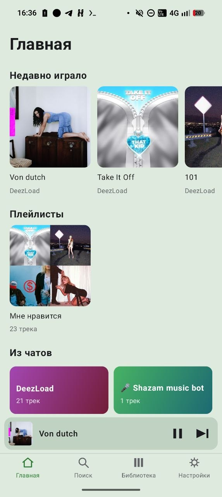
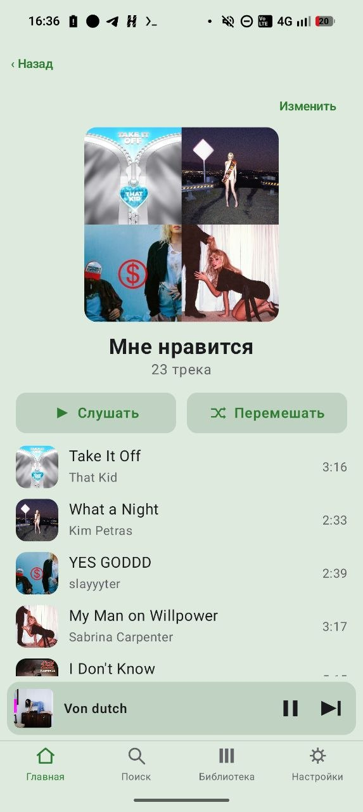
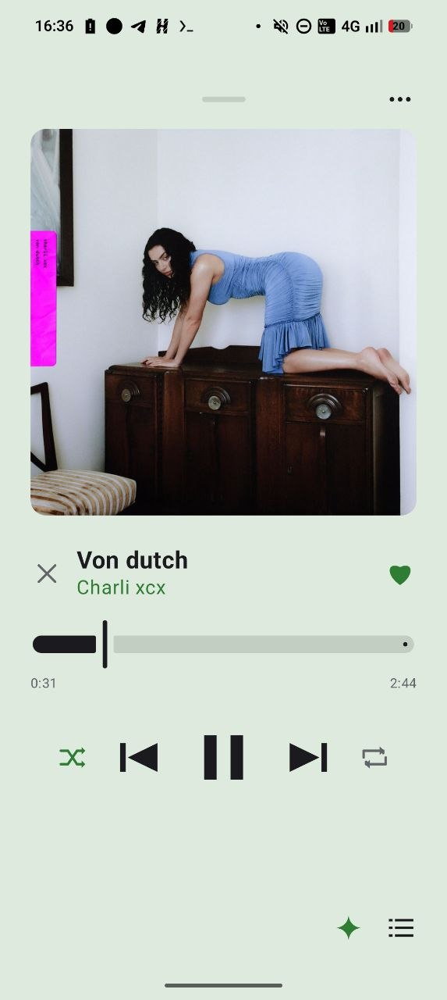

# sniff

Музыкальный плеер для музыки из Telegram

<table align="center">
  <tr>
    <td align="center"></td>
    <td align="center"></td>
    <td align="center"></td>
  </tr>
  <tr>
    <td align="center">Главное меню</td>
    <td align="center">Плейлист</td>
    <td align="center">Плеер</td>
  </tr>
</table>

## Скачать

[Скачать sniff.apk](https://github.com/sakurartro/sniff/releases/latest)

Нужен Android 8.0 или новее, процессор arm64 (почти все телефоны последних лет). APK ставится вручную: при установке Android попросит разрешить установку из неизвестных источников.

## Как это работает?

При первом открытии вы входите в свой аккаунт, выбираете чаты, где лежит ваша музыка, и всё! Вы можете слушать музыку из Telegram в красивом, удобном интерфейсе.

Приложение ничего не удаляет и не изменяет в ваших чатах. Сессия Telegram хранится только на телефоне и не попадает в бэкапы.

## Функции

- **Темы.** На выбор есть темы разных цветов, у каждой темы есть вариация: тёмная и светлая.
- **Рекомендации.** Опираясь на вашу текущую очередь, приложение подбирает похожие треки и добавляет их в очередь (каждый 4-й трек, он помечен ✨). Похожие треки определяет Last.fm, а сам файл приносит бот для поиска музыки. Рекомендации можно включить или выключить в настройках.
  Чтобы они работали, подключите в настройках хотя бы одного бота: `@shazambot` (быстрее) или `@deezload2bot` (медленнее). Это делается в два клика. Эти же боты дают поиск по трекам вне ваших чатов.
  *Не реклама, мы не имеем отношения к этим ботам.*
- **Плейлисты, исполнители, поиск** (по вашим трекам и по трекам из ботов): всё как в любом музыкальном приложении.
- **Кэш.** Настройка максимального размера кэша треков и его очистка.

### Что важно знать про ботов и сторонние сервисы

- Для рекомендаций и поиска приложение пишет выбранному боту от вашего аккаунта (запрос и команда `/start`), а уведомления этого чата выключает и помечает его прочитанным. Ответы бота остаются в его чате, их приложение не удаляет.
- Название и исполнитель трека отправляются в Last.fm (подбор похожих) и в iTunes (обложки). Больше ничего за пределы Telegram не уходит.

## Какие наши планы?

- ПК-клиент под все ОС, запуск в Arch User Repository и т. д.
- Система учёта прослушиваний, статистика за день, неделю, месяц, год
- Добавление треков в профиль Telegram прямо из приложения
- Тексты песен в live-режиме
- Интеграция LLM для подбора музыки по настроению
- И многое, многое другое...

## Сборка из исходников

Нужны ключи Telegram (получить на https://my.telegram.org) и, для рекомендаций, ключ Last.fm. Они вшиваются в сборку через переменные окружения:

    SNIFF_API_ID=123 SNIFF_API_HASH=abc LASTFM_API_KEY=xyz \
      cargo ndk -t arm64-v8a -o android/app/src/main/jniLibs build --release -p sniff-ffi

Дальше генерируются Kotlin-биндинги и собирается APK (`gradle -p android assembleRelease`). Точные шаги лежат в [`.github/workflows/android.yml`](.github/workflows/android.yml), устройство проекта описано в [`architecture.md`](architecture.md).

## Лицензия

Copyright © 2026 sakurartro.

Этот проект распространяется под лицензией **GNU General Public License v3.0**, подробности смотрите в файле [LICENSE](LICENSE).
